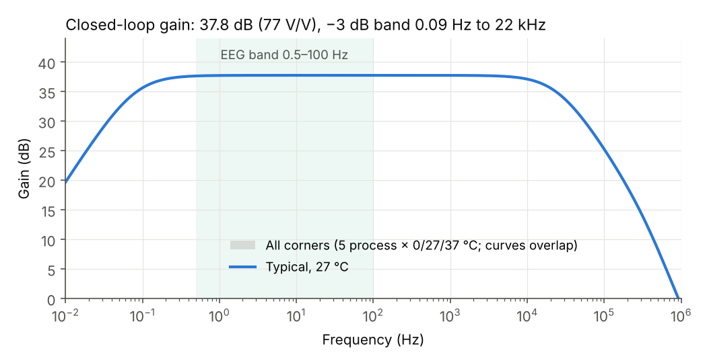
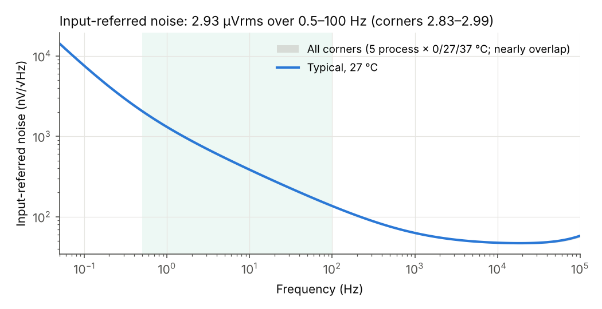
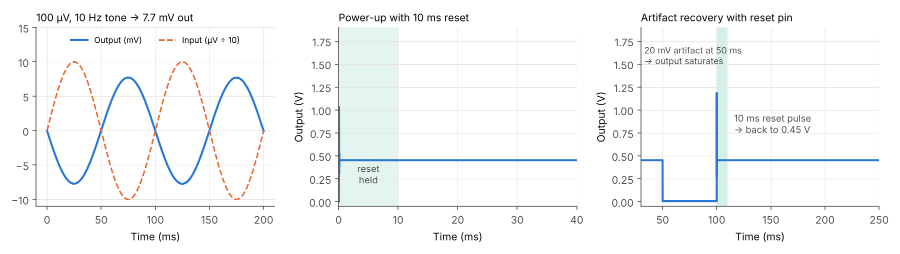

# Neonatal EEG Analog Front-End: SKY130 / Tiny Tapeout

**Status:** design v1, Xschem schematics + testbench, simulated in ngspice on both SKY130 model sets (original binned and newer continuous). Layout has not started.
**Next:** follow `docs/IMPLEMENTATION_GUIDE.md` (tools → schematics → verification → Tiny Tapeout repo → layout → post-layout → submit).
**Target:** Tiny Tapeout TTSKY26d, which closes on 30 November 2026. It uses a 1x2 analog tile with 2 analog pins and costs €220.

The chip is a low-noise capacitive-feedback biopotential amplifier for neonatal EEG. It is the analog front-end for the FPGA neonatal-seizure detector on the KV260.





## 1. Specification and simulated results

Results are typical corner, 27 °C, 1.8 V unless stated. "Corners" means 5 process corners (tt/ss/ff/sf/fs) × 0, 27 and 37 °C × 1.71, 1.8 and 1.89 V. Two numbers are given where the model sets differ: **classic** = `libs.tech/ngspice` (original binned models, used for the design), **continuous** = `libs.tech/combined` (newer models, Xschem's default). See §4.

**Operating temperature: 0–50 °C** (lab bench and body temperature). Above that the pseudo-resistors and junction leakage take over (§5).

| Parameter | Target | Classic models | Continuous models | Status |
|---|---|---|---|---|
| Supply | 1.8 V (VDPWR) | 1.71–1.89 V checked | same | ✓ |
| Midband gain | 38 ± 1 dB | 37.79 dB (77.5 V/V); corners 37.79 dB | 37.79 dB; corners 37.79 dB | ✓ |
| High-pass corner f_L | ≤ 0.5 Hz | MOS pseudo-resistor alone: 0.006–0.01 Hz at 0 °C, 0.04–0.14 Hz at 37 °C, 0.19–0.46 Hz at 50 °C | not separately checked | ✓ to 50 °C (§5) |
| Low-pass corner f_H | ≥ 100 Hz | 22–25 kHz | 18–20 kHz | ✓ |
| Input-referred noise, 0.5–100 Hz | ≤ 4 µVrms (goal 3) | **2.93 µVrms**; ≤ 3.00 over corners | **3.05 µVrms**; ≤ 3.08 over corners; ≤ 3.11 up to 55 °C | ✓ |
| Linear range | ≥ 1 mV input | THD 0.007 % at 1 mV, 0.19 % at 5 mV | 0.002 %, 0.24 % | ✓ |
| PSRR at 50 Hz | ≥ 40 dB | 96.5 dB | 90.7 dB | ✓ |
| Supply current | ≤ 20 µA | 15.7 µA (≈ 28 µW); 13.3–16.9 µA over corners | 12.2 µA; 10.9–12.9 µA | ✓ |
| Bias unit current | 0.5 µA | 0.50 µA (0.43–0.62 µA, 0–70 °C); RS = 92 kΩ | 0.39 µA (0.35–0.45 µA); RS = 118 kΩ | ✓ |
| Bias start-up from a supply ramp | always starts | 30/30 corner runs, settled < 0.1 ms, X < 20 mV | 30/30 | ✓ |
| VREF / output DC level | ≈ 0.45 V | 0.45 V (0.39–0.50 V) | 0.44 V (0.37–0.50 V) | ✓ |
| Recovery from a 20 mV artifact | < 50 ms | 10 ms `rst` pulse → output back at VREF ± 1 mV | same | ✓ |
| Power-up settling | < 50 ms | 10 ms `rst` pulse (≈ 15 s without it) | same | ✓ |
| Saturation margin, OTA devices | > 0.1 V | ≥ 0.04 V (worst: tail M5 at ss/0 °C/1.71 V; ≥ 0.09 V elsewhere) | ≥ 0.09 V; with mismatch ≥ 0.07 V (100 MC samples at ss/0 °C/1.71 V) | ⚠ §5 |
| Monte Carlo mismatch, 200 samples (tt, 27 °C) | gain spread < 1 % | not run (§4) | gain 77.70 V/V, σ = 0.044 V/V (0.06 %); output DC offset −0.23 mV, σ = 0.26 mV; VREF σ = 3.2 mV; unit current σ = 4.4 %; IDD 9.3–15.3 µA | ✓ |
| Area | 1x2 tile (≈160 × 225 µm) | MIM ≈ 14,000 µm² (≈ 40 % of tile); transistors ≈ 4,000 µm² active | | to confirm in layout |

The test environment models the Tiny Tapeout analog path as 500 Ω + 5 pF on each pin. The load is 15 pF ∥ 1 MΩ, standing in for a scope probe or ADC input.

## 2. Architecture

The four schematic sheets are in `docs/EEG_front_end_schematic_v1.pdf`. The editable Xschem schematics are in `xschem/` (pictures in `xschem/img/`); `xschem/tb_eeg_afe.sch` is the testbench to open first.

- **Sheet 1, top level:** `ua[0]` → C1 (11.9 pF) → OTA inverting input, with C2 (154 fF) ∥ PR1 ∥ S1 in feedback. The non-inverting side uses C1′ to ground and C2′ ∥ PR2 ∥ S2 to VREF.
  - Gain is set by C1/C2. C1′ goes to ground, so VREF noise reaches the output with gain ≈ 1 instead of 78, and a simple on-chip VREF is good enough.
- **Sheet 2, OTA:** a two-stage Miller OTA.
  - Input pair: PMOS, 150/8 µm each.
  - Mirror: NMOS, each side built as three 7/20 µm devices in series (effective L = 60 µm).
  - Tail: 4 µA. Second stage: 10 µA. Compensation: Cc = 2 pF with Rz = 20 kΩ.
  - Open-loop gain is 99 dB. In this circuit the feedback factor is about 1/80, which gives a loop phase margin of 86°.
- **Sheet 3, bias, VREF and pseudo-resistors:**
  - Bias: a subthreshold beta-multiplier (K = 4, Rs = 92 kΩ xhigh_po) giving 0.5 µA per 4/2 µm PMOS unit cell, plus a start-up circuit.
  - VREF: the Vgs of a weak-inversion NMOS diode.
  - Pseudo-resistors: each is two back-to-back PMOS pairs in series.
  - Reset: switches tie the pseudo-resistor internal nodes together, and S1/S2 short the pseudo-resistors.
- **Sheet 4:** device sizes.

## 3. Changes from the first hand-calculated design, and why

| Change | Reason, from simulation |
|---|---|
| Removed the output buffer A2 | With a feedback factor of 1/78, A1 is stable driving 15 pF directly (86° loop phase margin). Removing it saves area and 20 µA. |
| VREF changed from 0.9 V to 0.45 V | SKY130 pfet_01v8 has a high threshold (Vsg ≈ 1 V at these currents). Even at a 0.6 V input common mode the tail source M5 had only 0.2 V across it, and at 0.9 V it would cut off. At 0.45 V its saturation margin is at least 0.17 V in every corner. |
| Mirror M3/M4 changed from 2/4 µm to three 7/20 µm devices in series | The mirror's 1/f noise dominated (total 22 µVrms). Input-referred mirror 1/f noise scales roughly with 1/L², so long stacked devices brought the total to about 4 µVrms, and 3.5 µVrms with three in series. |
| C1 increased from 8 pF to 11.9 pF; input pair widened | The input pair's capacitance (≈ 3 pF) raises noise gain by (C1 + C2 + Cin)/C1. A larger C1 reduces this and brought noise to 2.9 µVrms. |
| Tail current increased from 1 µA to 4 µA | Lower input-pair noise for about 5 µW more power. |
| Added `rst` (ui_in[0]) reset switches | Pseudo-resistors alone took ≈ 15 s to settle at power-up. After a 20 mV artifact the output stayed saturated for more than 5 s. |
| Start-up circuit strengthened | The first version never released: X stayed at 0.64 V and injected current permanently, making the bias current supply-dependent (0.8–1.2 µA). |
| VREF diode resized | The first VREF came out at 0.68 V. Matching it to the bias diode at a lower current density gives 0.45 V. |
| Start-up pull-up MS1: 4 × 0.42/20 µm → 6 × 0.6/20 µm | The continuous models reject the 0.42/20 µm PMOS in the ss corner (bin 41, Pclm < 0), so no ss simulation could run. 0.6 µm width is in a valid bin; six in series keep the same weak pull-up. |

## 4. How the simulations are set up

- **Simulator and models:** ngspice 42–47 with the SkyWater `sky130_fd_pr` models. Corners: tt/ss/ff/sf/fs.
  - The PDK has two model sets and the design is checked on both. `libs.tech/ngspice` holds the original binned models; `run_all.py` uses it by default. `libs.tech/combined` holds the newer continuous models; Xschem's SKY130 setup uses it, and the scripts use it with `SKY130_LIB=combined`.
  - The main difference for this design is the xhigh_po resistor: 28 % higher in the continuous models, so the bias current is 22 % lower. Gain is set by C1/C2 and does not move. Silicon will show which is closer.
  - All transistors stay inside the model bins (finger W ≤ 7 µm, L ≤ 20 µm). Wider devices are built from parallel fingers, and longer ones as series stacks.
- **Pseudo-resistor:** AC and noise runs use its small-signal equivalent, a linear 1.3×10¹³ Ω resistor with 4kT/R noise; transient runs use the real MOS devices. The real zero-bias resistance is strongly temperature dependent (`tb_pr.py`: 1.8×10¹⁴ Ω at 0 °C, 2×10¹³ Ω at 37 °C, 5×10¹² Ω at 50 °C, typical), so the f_L values in §1 come from `tb_pr.py`, not from the AC run.
- **Passive components:** Rz is the PDK `res_xhigh_po_0p35`. The MIM capacitors (C1, C2, Cc, CREF) are simulated as ideal capacitors whose value is fitted to the PDK model (2.0 fF/µm² + 0.168 fF/µm perimeter, < 0.1 % error). The PDK MIM model's milliohm series resistors make the 10¹³ Ω nodes numerically ill-conditioned in DC and ~200× slower in transient (measured: 748 s vs 3 s for a 60 ms run). LVS netlists use the PDK model.
- **Monte Carlo:** `tb_mc.py` uses the continuous models, which apply mismatch to every device separately (transistors, resistors and MIM capacitors, scaled by 1/√area). Each sample has its own `.option seed`, so runs are reproducible. The original binned models are not used for Monte Carlo.
- **Solver settings:** `gmin = abstol = 1e-15`. With the default `gmin = 1e-12`, the solver adds about 1 TΩ of fake leakage at the high-impedance nodes.
- **Time step:** transient runs use ≤ 2 µs steps around reset edges. Coarser steps produce false jumps at reset release; this was checked at 20 µs, 2 µs and 0.5 µs.

## 5. Known risks and open items

1. **Temperature limit, 50 °C.** Above about 50 °C two effects grow exponentially. The pseudo-resistors fall to about 10¹² Ω, so f_L rises past 0.5 Hz (1.2–2.6 Hz at 70 °C). Reverse-junction leakage of the switches and n-wells, a few fA at 27 °C, reaches tens of fA and pulls the 10¹³ Ω input nodes off their DC level. At 70 °C the AC analysis fails in tt/ss/fs. Earlier versions of this README showed 70 °C passing because the first hand-written netlist had no junction areas (no junction leakage); the Xschem netlist has them, so these results are more realistic. Neonatal EEG works at body temperature and the chip is tested on a bench, so 0–50 °C is the specified range.
2. **Pseudo-resistors are poorly modelled.** Silicon values can differ by 10× from simulation, which would move f_L. The `rst` pin and the low design value (≤ 0.14 Hz at 37 °C) leave margin. Measuring f_L on silicon is part of the plan.
3. **Reset switches add leakage at the input nodes.** They are part of item 1 and, at 55–60 °C, start adding noise in the fs corner (5–72 µVrms at 60 °C; ≤ 3.2 µVrms at 55 °C).
   - A v2 option: replace them with T-switches (two series NMOS with the middle node held at VREF when off) or DNW-isolated switches; this would push the temperature limit up.
4. **Tail-current-source headroom.** M5 has 0.04 V saturation margin at ss/0 °C/1.71 V (classic models): the PMOS input pair's Vsg is about 1.1 V cold in ss. Gain and noise still meet spec there. Mismatch moves it very little (σ = 8 mV in Monte Carlo; worst of 100 samples 0.07 V on the continuous models). If more margin is wanted: lower VREF by 30–50 mV (costs the 5 mV linear-range margin, not the 1 mV spec) or use `pfet_01v8_lvt` for M1/M2.
5. **Not yet done:** real Cc/CREF devices in a full run, layout parasitics, and a model of Tiny Tapeout's analog mux (`tt_asw_3v3`). The mux is approximated here by 500 Ω + 5 pF.
6. **Output DC level** is VREF (≈ 0.45 V), not mid-rail. That is fine for small EEG signals: the linear range is ±5 mV at the input.

## 6. Files

```
xschem/
  gen_schematics.py   generates every .sch/.sym below (net labels on all pins: correct by construction)
  tb_eeg_afe.sch      testbench: power-up, 10 ms reset, 100 uV/10 Hz tone, pad + load models (open this)
  eeg_afe_top.sch     top (ua0, ua1, rst, vdd, vss) -> bias.sch, afe.sch -> ota.sch, pseudo_r.sch
  xschemrc            uses the PDK's xschemrc when $PDK_ROOT is set; MIM_MODEL selects PDK/ideal MIM
  netlist/            eeg_afe_top.spice (LVS-style, used by sim/), tb_eeg_afe.spice
  img/                PNG/SVG of each sheet
sim/
  reference/      the original hand-written netlists (ota/afe/bias/top.sub.spice) used for sizing
  compare_designs.py  checks the Xschem netlist against sim/reference (matches within 0.3 %)
  spice.py        runs ngspice on the Xschem netlist (EEG_DESIGN=reference for the old one); picks the SKY130 library (SKY130_LIB, $PDK_ROOT, or the dev copy)
  tb_ac.py        closed-loop AC, noise, operating point
  tb_tran.py      power-up, test tones, artifact and reset (MOS pseudo-resistors)
  tb_bias.py      bias generator corners (DC), plus the RS resistor value
  tb_startup.py   bias start-up from a supply ramp, all corners (transient)
  tb_pr.py        pseudo-resistor I-V and zero-bias resistance vs temperature
  tb_mc.py        Monte Carlo mismatch (gain, output offset, VREF, bias current, M5 margin)
  corners.py      60-point corner sweep (results/corners.json, or corners_combined.json)
  run_all.py      re-runs everything and writes results/summary.json
  make_plots.py   figures in results/
results/          figures (fig4_montecarlo.png), montecarlo.json, summary.json / summary_combined.json, corners.json / corners_combined.json, schematic PDF
docs/             IMPLEMENTATION_GUIDE.md, schematic sheets (PNG + PDF) and the scripts that draw them
tinytapeout/      info.yaml, src/project.v stub, docs/info.md
```

## 7. Running it on your laptop (Windows)

1. Install the IIC-OSIC-TOOLS container, which includes Xschem, ngspice, Magic, KLayout, Netgen and the SKY130 PDK.
   - In PowerShell as Administrator: `powershell -c "irm https://osic.tools/install.ps1 | iex"`
   - This sets up WSL2, Docker Desktop and the repository.
2. Double-click `start_vnc.bat`, then open the URL it prints (usually `http://localhost/?password=abc123`).
3. Copy this folder into your designs directory (default `%USERPROFILE%\eda\designs`, which appears as `/foss/designs` inside the container). Then run:
   ```
   sak-pdk sky130A
   cd /foss/designs/eeg_frontend/sim
   python3 run_all.py --quick                      # classic models, 3-7 minutes; drop --quick for the 60 corners
   SKY130_LIB=combined python3 run_all.py --quick  # continuous models
   ```
   The numbers should match `results/summary.json`. `spice.py` finds the PDK through `$PDK_ROOT` automatically.

## 8. Plan to 30 November

| Week | Work |
|---|---|
| 20–22 Oct | Set up the tools and reproduce these results (guide Step 0–1). Read every block until you can explain each size. |
| 23 Oct – 2 Nov | Monte Carlo, real CREF/Cc check, PSRR (Step 2). Tiny Tapeout repo (Step 3). Floorplan in the 160 × 225 µm tile. |
| 3–23 Nov | Layout in Magic/KLayout: MIM caps first, then the common-centroid input pair, the mirror stacks and the bias. DRC and LVS clean. Lighter during exams. |
| 24–30 Nov | Extraction and post-layout simulation. GDS/LEF into the Tiny Tapeout template. GitHub repo. Submit. |

Chips are expected around May–June 2027. Silicon measurements (gain, f_L, noise, artifact recovery) then become paper material.
