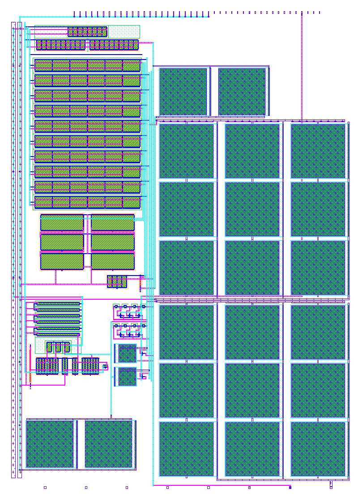

## How it works

A capacitive-feedback biopotential amplifier for neonatal EEG, built in SkyWater SKY130.

- The input `ua[0]` is AC-coupled through C1 = 11.9 pF into a two-stage Miller OTA with C2 = 154 fF in feedback, giving a midband gain of C1/C2 ≈ 77.5 V/V (37.8 dB).
- A MOS pseudo-resistor (two back-to-back PMOS pairs in series, about 10¹³ Ω) across C2 sets the high-pass corner well below 0.5 Hz (0.04–0.14 Hz at 37 °C in simulation), so electrode DC offsets are blocked. The OTA bandwidth sets the low-pass corner at 18–22 kHz.
- The OTA uses a large PMOS input pair (W/L = 150/8 µm) and long stacked NMOS mirror devices (effective L = 60 µm) to keep 1/f noise low: 2.9–3.1 µVrms input-referred over 0.5–100 Hz in simulation.
- An on-chip subthreshold beta-multiplier with a start-up circuit provides 0.4–0.5 µA unit currents, and a diode-connected NMOS provides VREF ≈ 0.45 V, which is the output DC level.
- `ui_in[0]` (rst) closes small NMOS switches across the pseudo-resistors. This forces the output to VREF, which is needed because pseudo-resistors alone take seconds to settle after power-up or a large artifact.

Simulated pre-layout on both SKY130 model sets (typical corner, 27 °C): 12–16 µA from 1.8 V (22–28 µW), PSRR 91–97 dB at 50 Hz, THD 0.19–0.24 % for a 5 mV input amplitude at 10 Hz. Over 200 Monte Carlo mismatch samples the gain varies by σ = 0.06 % and the output DC offset by σ = 0.26 mV. Specified temperature range: 0–50 °C.

The layout (below) is DRC and LVS clean. Simulated with its extracted parasitic capacitances, the gain is within 0.05 dB of the schematic and the noise within 0.03 µVrms, at all five process corners and at 0 and 50 °C. The PSRR at 50 Hz is 81–91 dB.

## How to test

1. Power the chip, select this project, and hold `ui_in[0]` high for at least 10 ms, then set it low.
2. Drive `ua[0]` with a small sine (for example, 100 µV at 10 Hz) referenced to board ground. A resistive divider from a function generator works, for example 1 kΩ / 10 Ω from a 10 mV source.
3. Measure `ua[1]` with an oscilloscope or ADC. Expect about 7.7 mV amplitude around a DC level of about 0.45 V.
4. To measure noise, short `ua[0]` to ground through a small resistor, record `ua[1]` with a 16-bit or better ADC, and divide by the gain.
5. After an input overload, pulse `ui_in[0]` high for 10 ms to recover immediately.

## External hardware

A function generator with an attenuator, an oscilloscope or ADC (for example, the KV260 or a Raspberry Pi with an external ADC), and optionally EEG electrodes for a live demo.
